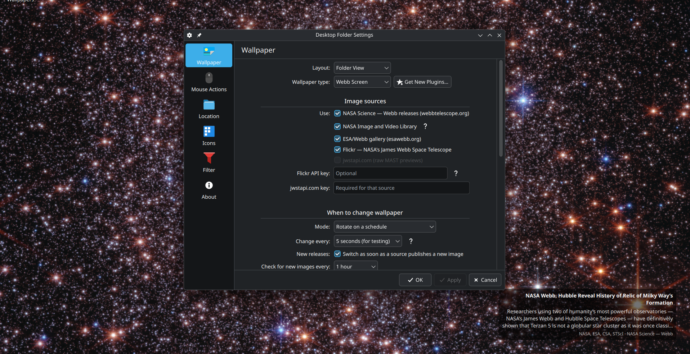

# Webb Screen

A KDE Plasma 6 wallpaper plugin that keeps your desktop stocked with fresh
imagery from the James Webb Space Telescope.

[](LICENSE)


[](https://www.opendesktop.org/p/2370853/)



New Webb releases from NASA Science and ESA/Webb (and, optionally, MAST) are
merged into one stream, deduplicated and sorted newest first. The plugin picks a picture,
downloads the largest variant that fits your download budget, and optionally
names it in a small card on the desktop. Nothing to compile — image downloads
and cache housekeeping run through `curl` on Plasma's `executable` data engine.

## Requirements

- KDE Plasma 6 (Qt 6 / KF6)
- `kpackagetool6` (`kf6-package` / `kpackage`) — to install the plugin
- `curl` and coreutils — used at runtime for downloads and cache pruning

## Install

From within Plasma: *Configure Desktop and Wallpaper* → **Get New Plugins…** →
search for *Webb Screen*. It is published on
[openDesktop](https://www.opendesktop.org/p/2370853/), which is the same
catalogue that button reads from.

From source:

```sh
git clone https://github.com/postadelmaga/WebbScreen.git
cd WebbScreen
./install.sh
systemctl --user restart plasma-plasmashell.service
```

Then right-click the desktop → *Configure Desktop and Wallpaper* → wallpaper
type **Webb Screen**.

`install.sh` upgrades an existing installation in place, so re-running it after
a `git pull` is enough. To remove the plugin and its image cache:

```sh
./uninstall.sh
```

## Sources

| Source | API key | Notes |
| --- | --- | --- |
| **NASA Science — Webb** (`science.nasa.gov`) | no | `webbtelescope.org` (STScI) has been retired and now redirects here. Read through the WordPress REST API as *science assets*: one record per picture rather than per press release, each titled for what it shows, classified (photograph, artist concept, infographic, spectrum, video…) and listing its native size. The 100 most recent Webb stills, at up to native resolution. **The main source.** |
| **ESA/Webb** (`esawebb.org`) | no | RSS image feed (the last 25 images); the CDN serves `large` (full-resolution), `wallpaper5`, `wallpaper4` and `screen` variants. Carries the same joint releases as NASA, plus ESA's own *Picture of the Month*, which appears nowhere else. |
| **jwstapi.com** (MAST) | required | Community index of processed JWST products. Off by default: it needs a key, and it returns raw instrument previews rather than press-ready pictures. |

Each source can be switched on or off independently in the wallpaper settings.
All enabled sources are merged and sorted newest first. A joint release goes out
from ESA and NASA at once under the same title, so the same picture is
recognised by its title and day and kept once — the NASA copy, which states its
size and can be rendered at exactly the width the screen needs.

Two earlier sources have been dropped. The NASA Image and Video Library indexes only
the July 2022 first-release set and nothing since. Flickr's keyless public feed
stops at 1024 px, so with the screen-width floor on it contributed nothing; with
a key it mirrored the NASA releases already fetched in full.

## Update policy

Three modes, chosen in the wallpaper settings:

- **Rotate on a schedule** — a new picture every 5 seconds … 1 week. The very
  short intervals are there for trying the plugin out.
- **Only when a new image is published** — the wallpaper stays put until a
  source publishes something new, then switches to it.
- **Manually** — only via *Next Webb Image* in the desktop context menu.

Rotating and polling are two independent clocks. Rotation moves through the
images already fetched — the pool is reused for 15 minutes — so a 5 second
interval costs one download per change and never re-queries the APIs. The
sources are polled separately, on the *Check for new images every* interval,
and a switch only happens when one is actually due.

In schedule mode, *Switch as soon as a source publishes a new image* makes a
fresh release take over immediately instead of waiting its turn. You can also
advance by hand at any time from the desktop context menu.

A release counts as new when it is dated after the newest one seen so far.
When several pictures land at once — a release usually brings a NIRCam and a
MIRI view — the newest is shown and the rest come up next in the rotation.

Which picture gets chosen is configurable too: the most recent one not shown
yet, a random one, or always the most recent.

## What counts as an image

*Only real photographs* (on by default) leaves out artist concepts,
illustrations, infographics, diagrams, spectra, compass and annotated versions,
side-by-side comparisons, and the occasional press photo of the observatory
itself.

science.nasa.gov classifies every picture, so for that source the request
itself asks for photographs only. ESA does not, but both sources name the
medium plainly and consistently in the title — `(artist's concept)`,
`transmission spectrum`, `(NIRCam Compass Image)` — so titles are matched too,
along with the unambiguous phrases in the caption ("An illustration of…").

Joint releases also file the other observatories' frames next to Webb's: the
Hubble view of the Cat's Head Nebula sits in the Webb stream beside the NIRCam
and MIRI ones. A picture whose title or instrument names Hubble, Chandra or
Spitzer and not Webb is left out whatever this setting says.

## History

The last 15 images are remembered — title, caption, credit, link, the cached
path and the exact variant URL — so stepping back works even after the cache
has pruned one: it is fetched again. Going back does not discard what is ahead;
showing a *new* image does, browser style.

## Resolution and cache

Each source offers the same picture in several sizes. Before downloading, the
plugin issues `HEAD` requests down the candidate list, biggest first, and takes
the first variant that fits the configured budget (25 MB by default — enough
for the full-resolution ESA/Webb releases, which run around 4000×4000). A
fixed 20 KB floor rejects error pages served with a 200.

*Download no more than the screen can show* (off by default) starts that list
at the smallest variant that is still large enough for the screen instead. The
wallpaper is drawn at screen resolution either way — the `Image` decodes no
more than that — so it looks the same, but on a 1920-wide screen a typical NASA
Science release is then 5 MB instead of 22 MB and takes a third of the CPU to
decode. science.nasa.gov renders any width, so it is asked for exactly the one
the screen needs. ESA's own variants are not reordered: its wallpaper sizes are
fixed crops, enlarged by ESA when the original is smaller than they are, so
they are only used once the original has proved too big for the budget. Leave
the option off if you keep what *Save a Copy to Pictures* hands you: that is
the file that was fetched.

*Only use images at least as large as the screen* (on by default) keeps every
picture from being enlarged on screen. What "large enough" means depends on the
positioning: *Scaled and cropped* and *Scaled* cover the whole screen, so the
picture must be both as wide and as tall as the screen in physical pixels (a
1746×982 desktop at 110 % is 1920×1080); the other modes fit it inside, where
reaching either edge is enough. It is applied twice. Before anything is
requested, a variant whose stated size falls short is dropped. After the
download the file itself is measured with `file`, which catches the pictures
whose size no source states (ESA's originals): one that falls short is deleted
and the next picture is tried. A cached copy that has become too small — a
bigger screen, a mode that needs more — is replaced the same way.

science.nasa.gov renders its images on the fly and answers neither
`Content-Length` nor range requests, so the size of a variant cannot be probed
there. Its rendition widths are estimated from the native size the asset lists
(PNG ≈ 1.6 bytes/pixel), and the real size is re-checked after the download — a
variant that blew the budget is deleted and the next smaller one is tried.

Images are cached in `~/.cache/webbscreen/`; the *Keep on disk* setting bounds
how many are retained (20 by default, oldest pruned first). Rotating back onto
an image still on disk costs nothing: the cache is checked in the same shell
that would have run the `HEAD` probes, so a switch onto a cached picture makes
no network requests at all. A cache entry is per image, not per variant: a copy
still large enough for the screen is kept even after raising the budget or
turning the screen-resolution option off — *Empty Cache* in the settings if you
want those re-fetched larger.

## Caption

A small card in a corner of the desktop (bottom right by default) names what
you are looking at: the subject title, a short description of it, and the
credit line. On by default; the description can be turned off on its own, and
the card can be moved to any of the four corners — or hidden entirely — in the
wallpaper settings.

## Desktop context menu

Right-click the desktop:

- **Previous Webb Image** — step back through the last 15 images
- **Next Webb Image** — forward through the history, or a new image once you are
  back at the end; straight from the cached pool either way
- **About "…"** — open the source's page for the current image
- **Open Wallpaper Image** — open the cached file
- **Save a Copy to Pictures** — copy it to `~/Pictures/WebbScreen/`

## Layout

```
package/
├── metadata.json                 KPackage manifest (Plasma/Wallpaper)
└── contents/
    ├── code/sources.js           the providers + filter/merge/sort/dedupe
    ├── code/commands.js          the shell commands (probe, download, prune)
    ├── config/main.xml           KConfigXT settings and persisted state
    └── ui/
        ├── main.qml              WallpaperItem: policy, download, display
        ├── config.qml            settings page
        ├── Shell.qml             async wrapper around the executable engine
        └── InfoOverlay.qml       optional on-desktop caption
```

`contents/code/sources.js` and `contents/code/commands.js` are plain JavaScript
with no QML dependencies, so both the providers and the generated shell
commands can be exercised outside Plasma; `main.qml` only wires them together.

## Notes and known limitations

- Metered-connection detection is not implemented; if you are on a capped
  link, use *Manually* or lower the download budget.
- QML's `XMLHttpRequest` has no timeout, so a stalled request would otherwise
  hang an update forever; a five-minute watchdog unblocks it.
- Plasma does not reload a wallpaper plugin while it is running: after an
  upgrade, restart plasmashell.

## Contributing

Bug reports and pull requests are welcome. Since everything is interpreted QML
and JavaScript, the edit cycle is `./install.sh` followed by a plasmashell
restart; `journalctl --user -f -u plasma-plasmashell.service` shows the plugin's
warnings.

## License

GPL-3.0-or-later — see [LICENSE](LICENSE).

The images themselves belong to their respective missions and carry their own
(generally permissive) terms: NASA/ESA/CSA/STScI. This project is not affiliated
with or endorsed by NASA, ESA, CSA or STScI.
